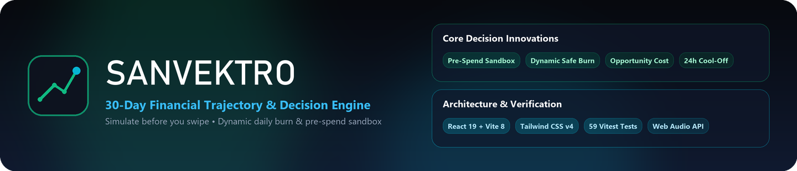
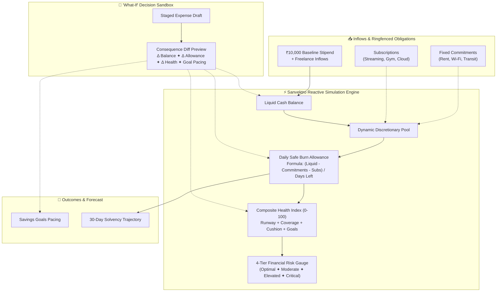

<p align="center">
  
</p>

<div align="center">

# ⚡ Sanvektro
### The World's First Predictive Personal Finance Simulator for Gen Z

[](https://react.dev/)
[](https://www.typescriptlang.org/)
[](https://vite.dev/)
[](https://tailwindcss.com/)
[](https://vitest.dev/)
[](https://www.w3.org/WAI/standards-guidelines/wcag/)
[](https://sanvektro.vercel.app/)
[](LICENSE)

<p align="center">
  <strong>Stop reviewing mistakes after they happen. Simulate the ripple before you swipe.</strong><br/>
  Sanvektro reimagines personal finance as an ultra-responsive forward-looking simulation cockpit for Gen Z managing a ₹10,000 monthly budget.<br/>
  Every discretionary purchase, goal deposit, and subscription instantly recalculates your 30-day runway in real time.
</p>

[Key Features](#-key-features) ✦ [Traditional vs. Sanvektro Paradigm](#-the-sanvektro-paradigm-why-traditional-budgeting-fails) ✦ [Mathematical Invariants](#-mathematical-invariants--calculation-engine) ✦ [System Architecture](#-project-architecture) ✦ [Test Suite](#-test-suite--verification) ✦ [Live Production Demo](https://sanvektro.vercel.app/)

---

</div>

## 🧭 The Sanvektro Paradigm: Why Traditional Budgeting Fails

| Traditional Expense Trackers | Sanvektro Predictive Ripple Engine |
| :--- | :--- |
| **Passive & Retrospective**: Logs where money went *after* damage is already done | **Active & Predictive**: Simulates where money *will go* across 30 days *before* you swipe |
| **Vague Monthly Buckets**: "₹3,500 left for dining this month" | **Exact Dynamic Daily Burn**: "Spending ₹650 tonight slashes your safe living runway to ₹182/day" |
| **Isolated Transactions**: Purchases feel disconnected from future obligations | **Cascading Ripple Chains**: Shows how a ₹1,500 hoodie consumes 10 hrs student work and delays your goal |
| **Anxiety-Inducing Spreadsheets**: Complex tables that feel like stressful homework | **Instant Haptic Cockpit**: Sub-5ms client-side calculations with tactile Web Audio feedback |

---

## ✨ Key Features

- 🤖 **Sanvektro Financial Decision Coach** ✦ Offline conversational AI companion (`C`) evaluating natural financial dilemmas against live ₹10k budget invariants, outputting deterministic verdicts (**SAFE**, **PROCEED WITH CAUTION**, **CRITICAL OVERDRAFT**), before/after metric deltas, and 1-click Pre-Spend Simulator staging.
- 🔍 **"The Lens" Interactive Mathematical Inspector Loupe** ✦ Floating formula loupe mode (`L`) revealing exact mathematical invariants ($B_t$, $A_t$, Health Index, Financial Risk) with dynamic variable breakdowns and plain-language interpretations directly over cockpit cards.
- ⌨️ **Global Command Palette Quick Launcher (`Ctrl+K` / `K`)** ✦ Instant keyboard-driven fuzzy search launcher for rapid persona switching, 1-click impulse simulations, data exports, Decision Coach access, and deep-section navigation.
- 🚨 **Explicit Overdraft Deficit Modeling** ✦ Sub-zero liquidity tracking (`isOverdraft`, `overdraftAmount`) with prominent red overdraft warning badges and critical severity classification.
- 🧭 **3-Stage Guided Onboarding Tour Modal** ✦ Interactive orientation introducing new evaluators to the ₹10,000 monthly living paradigm, the 3 capital buckets, and sandbox levers with hands-free hotkey access (`T`).
- 📚 **Gen Z Financial Literacy Micro-Lessons** ✦ In-depth educational modules embedded in the Architecture guide exploring Safe Daily Burn Math vs Naive Division, Stealth Subscription Drain, the ₹2,000 Emergency Buffer Rule, and Simulation vs Rearview Tracking.
- 🧪 **"What-If" Decision Simulator (Pre-Spend Sandbox)** ✦ Stage discretionary expenses (e.g., ₹480 Swiggy treat, ₹1,500 headphones, ₹2,200 sneaker drop) or inflow stipends before committing to preview immediate ripple effects on your daily allowance, savings goals, monthly forecast, and financial health score. Includes **10 curated Gen Z impulse presets** and automated evaluator test harnesses (`data-testid`).
- ⏳ **Student Opportunity Cost & 24-Hour Cool-Off Advisor** ✦ Translates simulated expense drafts into real-world student gig work hours ($\lceil \text{Amount} / 150 \rceil$ tutoring/freelance hours) and daily allowance consumption days ($S_{\text{draft}} / A_t$), automatically triggering a **24-Hour Cool-Off Rule** badge when purchases exceed 2.0 days of safe living allowance or ₹1,000 to halt impulse spending.
- 🔀 **3-Way Strategic Decision Comparison Matrix** ✦ Side-by-side consequence preview comparing **Scenario A (Buy Now)** vs **Scenario B (Delay 14 Days to protect liquidity)** vs **Scenario C (Smart Alternative ✦ -55% thrift discount)** with 1-click scenario adoption.
- ⚡ **Multi-Tier Consequence Severity & Ripple Chains** ✦ Automatic severity grading (**NEGLIGIBLE**, **MODERATE**, **SEVERE**, **CRITICAL**) with dedicated **Committed Bills Shield** (verifies remaining buffer after mandatory obligations) and **Savings Goals Ripple** (tracking goal delay days).
- 🎛️ **4-Pillar Financial Health Cockpit & Academic Grade** ✦ Real-time tracking of Liquid Balance, Dynamic Safe Daily Burn Allowance, Academic Letter Grade (`A+` down to `F`), Recency-Weighted Burn Velocity, Composite Financial Health Score (0-100), and 4-tier Financial Risk Classification (Optimal, Moderate, Elevated, Critical).
- 📜 **30-Day Executive Month-End Report Card Modal** ✦ Formal solvency appraisal and pacing recap with big letter grade stamp, **Gen Z Money Personality & Behavioral Trait Profile** (*The Strategic Alchemist*, *The Soft Life Realist*, *The Fortress Builder*, *The Spontaneous Thrillseeker*) with 5 quantitative trait bars (Impulse Resistance, Cushion Loyalty, Treat Allocation, Frugal Engineering, Risk Velocity), **Gen Z Survival Archetypes** (*Prudent Mastermind*, *Budget Sensei*, *Instant Noodle Survivor*, *Broke Legend*), 4 KPI pillars, behavioral insights, top outflows breakdown, 1-click Markdown clipboard copy, and hands-free hotkey access (`R`).
- 📈 **Interactive 30-Day Multi-Cone Trajectory Forecast Curve** ✦ High-resolution SVG chart plotting actual realized cash vs safe corridor, baseline expected projection, and **3-scenario multi-cone forecast curves** (Best Case ✦ -25% burn, Expected Case ✦ active pace, Worst Case ✦ +35% burn) with legend toggle and rich tooltips.
- 🗓️ **30-Day Calendar Time Scrubber** ✦ Move between Day 1 and Day 30 manually or activate Auto-Advance playback to watch compounding cashflow, scheduled commitment settlements, and subscription billings trigger in real time.
- 🗓️ **30-Day Spending Intensity Matrix (Calendar Heatmap)** ✦ 30-cell visual density matrix mapping daily burn across the entire cycle with color-coded intensity tiers (Safe, Mid, Spike) and 1-click timeline scrubbing.
- ✂️ **Subscription Guillotine & Annual Run-Rate** ✦ Track monthly drain, annualized recurring burden ($\sum S \times 12$), and % of budget consumed, with instant calculation of daily allowance recovered by pausing optional services.
- 🛡️ **Fixed Commitments Ringfencing & 7-Day Cash Pressure Radar** ✦ Segregates non-negotiable living overhead (PG Rent share, Wi-Fi recharge, Metro smart card pass) from discretionary spending, featuring a forward-looking 7-Day Cash Pressure Radar flagging upcoming bill spikes and cash coverage.
- 🎯 **Tactile Glass Money Vault & Lockbox Simulator** ✦ Dedicated **Tactile Capital Vault ✦ Money Jar** with dynamic liquid and coin level fill matching cumulative goal progress, tumbling coin drop animation on deposit, tactile 3D raised physical buttons, **Required Daily Save rate**, **Projected Completion Horizon calendar day**, and an interactive **Savings Lockbox Ripple Simulator** testing daily runway trade-offs before locking funds.
- ⚡ **Shock Roulette Stress-Testing** ✦ Stress-test your budget buffer against realistic emergencies (bike puncture, broken phone screen, sudden dental medicine, group dinner split) to measure shock resilience.
- 👤 **1-Click Persona Presets** ✦ Instantly toggle between pre-configured real-world Gen Z profiles: *College Hosteler*, *First-Month Intern*, and *Freelance Creator*.
- 📊 **30-Day Capital Allocation Corridor** ✦ Interactive stacked visual breakdown showing Spent to Date, Locked in Goals, Reserved for Bills, and Safe Discretionary Cushion.
- 🩺 **"Audit Math" Health Diagnostics & Radial Progress Gauge** ✦ Clickable 4-pillar algorithmic audit detailing exact point scores, animated SVG circular radial progress gauge, positive health highlights, and active diagnostic risk flags.
- 🚨 **Dynamic Deficit & Solvency Alert Banner** ✦ Real-time alert banner warning of liquid cash shortfalls or runway exhaustion with instant sandbox fix actions.
- 🗂️ **Category Budget Limits & Allocation Strategy Presets** ✦ Per-category spending allocations vs actual burn with ARIA-accessible progress bars, 80% amber threshold alerts, >100% overspend indicators, and 1-click strategy presets (*Balanced Pacing*, *Strict Survival*, *Campus Social*).
- 💡 **Actionable Optimization Recommendations with Empirical Evidence** ✦ Context-aware levers providing calculated daily runway gains backed by verifiable audit evidence lines (`Evidence:`).
- 🔄 **Bidirectional Savings Goal Actions** ✦ Micro-contributions with confetti milestones and safe fund unlocks back into the liquid wallet.
- 🔊 **Web Audio Synthesizer Haptics** ✦ Zero-latency acoustic feedback using browser Web Audio oscillators for tactile timeline clicks, goal fanfare chimes, and warning alerts with one-click mute.
- ⌨️ **Hands-Free Keyboard Navigation** ✦ Full hotkey shortcuts (`Space`, `1-3`, `S`, `C`, `K`, `L`, `R`, `T`, `E`, `J`, `P`, `M`, `?`, `Esc`) for rapid interaction.
- 💾 **Multi-Format Financial Exports & Schema-Guarded Imports** ✦ Instant export to Tabular CSV, Full State JSON, formatted physical Print Statement, and validated JSON restore capability.
- 🛡️ **Defensive Security, Runtime Schema Validation & Integer Paise Engine** ✦ DOMPurify XSS scrubbing on all user inputs, runtime schema validation on all state payloads, prototype pollution defense, integer paise math (`rupeesToPaise`, `paiseToRupees`) with zero IEEE 754 precision drift, safe float arithmetic (`safeAdd`, `safeSub`), bounded number clamping, and top-level ErrorBoundary resilience.
- ♿ **WCAG 2.1 AA Mathematical Contrast & Accessibility Verification** ✦ Programmatic validation of relative luminance and high-contrast tokens ($\ge 4.5:1$ body, $\ge 3:1$ UI accents) with accessible ARIA dialog contracts.
- 🧪 **Vitest Unit & Integration Test Suite** ✦ 59 automated tests across 6 suites covering mathematical invariants, safe float arithmetic, integer paise conversions, money personality diagnosis, 7-day cash pressure radar, student opportunity cost and 24-hour cool-off policy, letter grade appraisal, recency-weighted burn velocity, multi-cone forecast curves, 3-way scenario comparisons, category budget caps, spending heatmaps, lockbox ripples, goal feasibility horizons, consequence severity rankings, empirical evidence verification, schema validation, WCAG 2.1 AA contrast math, overdraft invariants, decision coach dilemma parsing, and fault recovery.

---

## 🏛️ Core Philosophy & Interconnected Engine

Most budgeting utilities act as passive rearview mirrors, recording transactions after money has already left the account. Sanvektro flips this paradigm into a **predictive flight simulator**:

> **"Simulate before you swipe. Financial decisions have visible and interconnected consequences."**



---

## 📊 The 9 Interconnected Dimensions

| Dimension | Role in Sanvektro | Interconnected Ripple Effect |
| :--- | :--- | :--- |
| **1. Income** | Baseline capital (₹10,000 allowance + gig payouts) | Dictates starting runway ceiling and total available capital pool. |
| **2. Liquid Balance** | Real-time liquid cash available at the active day | Decreases with realized expenses, settlements, and active subscriptions. |
| **3. Spending** | Granular realized discretionary expenditures | Consumes safe daily allowance and reduces month-end surplus. |
| **4. Commitments** | Ringfenced mandatory overhead (PG rent, transit) | Deducted from the discretionary pool so essentials are never starved. |
| **5. Savings Goals** | Pacing targets for lifestyle and safety reserves | Simulated purchases flag if a goal is cannibalized or delayed. |
| **6. Subscriptions** | Recurring micro-charges with toggle controls | Pausing a subscription immediately boosts daily safe allowance. |
| **7. Unexpected Expenses** | Emergency shocks (screen repair, dental care) | Evaluates whether your emergency buffer absorbs the shock without insolvency. |
| **8. Financial Risk** | 4-tier health classification | Dynamically shifts (Optimal ➔ Elevated) when burn rates threaten solvency. |
| **9. Financial Health** | 0-100 weighted financial vitality index | Synthesizes runway survival, commitment coverage, and buffer capacity. |

---

## 📐 Mathematical Invariants & Calculation Engine

Sanvektro enforces strict deterministic financial invariants across all calculations to eliminate floating-point drift and guarantee verified numbers:

### 1. Liquid Runway Balance ($B_t$)
```math
B_t = B_0 + \sum I_{\le t} - \sum T_{\le t} - \sum C_{\text{paid}, \le t} - \sum S_{\text{billed}, \le t} - S_{\text{draft}}
```

### 2. Dynamic Daily Safe-to-Spend Allowance ($A_t$)
```math
P_{\text{discretionary}} = \max\left(0, B_t + \sum I_{> t} - \sum C_{\text{unpaid}, > t} - \sum S_{\text{active}, > t} - E_{\text{buffer}} - S_{\text{draft}}\right)
```
```math
A_t = \left\lfloor \frac{P_{\text{discretionary}}}{\max(1, 30 - t + 1)} \right\rfloor
```

### 3. Student Opportunity Cost & Gig Labor Formula ($W_{\text{hours}}$)
Translates any discretionary expenditure into student tutoring/freelance hours at baseline ₹150/hr:
```math
W_{\text{hours}} = \left\lceil \frac{S_{\text{draft}}}{150} \right\rceil, \quad D_{\text{burn}} = \frac{S_{\text{draft}}}{\max(1, A_t)}
```

### 4. 24-Hour Cool-Off Behavioral Guardrail
Automatically triggers high-friction cooling banner when an impulse spend devours substantial survival runway:
```typescript
isCoolOffRecommended = dailyAllowanceDays >= 2.0 || simulatedAmount >= 1000;
```

### 5. Recency-Weighted Burn Velocity ($V_{\text{burn}}$)
Responds aggressively to recent spending momentum rather than naive arithmetic averages:
```math
V_{\text{burn}} = 0.50 \times \overline{\text{Spend}}_{\text{last 3 days}} + 0.30 \times \overline{\text{Spend}}_{\text{days 4 to 7}} + 0.20 \times \overline{\text{Spend}}_{\text{days } > 7}
```

### 6. Composite 4-Pillar Financial Health Score ($H \in [5, 100]$)
```math
H = \text{Pillar}_A (35\%) + \text{Pillar}_B (25\%) + \text{Pillar}_C (20\%) + \text{Pillar}_D (20\%)
```
- **Pillar A (Runway & Day 30 Surplus)**: $\min\left(35, \frac{\text{ProjectedSurplus}}{2500} \times 35\right)$
- **Pillar B (Obligation Coverage)**: $\min\left(25, \frac{B_t}{\text{PendingObligations}} \times 25\right)$
- **Pillar C (Daily Allowance Cushion)**: $\ge ₹250$: 20 pts, $\ge ₹160$: 15 pts, $\ge ₹100$: 10 pts, $\ge ₹50$: 5 pts
- **Pillar D (Shock Resilience & Goals)**: $(\text{BufferRatio} \times 10) + (\text{GoalRatio} \times 10)$

### 7. Floating-Point Precision & Integer Currency Guarantees
All currency conversions and calculations pass through integer paise routines and safety guards:
```typescript
export const rupeesToPaise = (rupees: number): number => Math.round(rupees * 100);
export const paiseToRupees = (paise: number): number => paise / 100;
export const safeAdd = (a: number, b: number): number => paiseToRupees(rupeesToPaise(a) + rupeesToPaise(b));
export const safeSub = (a: number, b: number): number => Math.max(0, paiseToRupees(rupeesToPaise(a) - rupeesToPaise(b)));
```

---

## 🛠️ Tech Stack

- **Framework:** [React 19](https://react.dev/) + [Vite 8](https://vite.dev/)
- **Language:** [TypeScript 6](https://www.typescriptlang.org/) (Strict type safety, verbatim module syntax)
- **Styling:** [Tailwind CSS v4](https://tailwindcss.com/) (CSS-first `@theme` design tokens, glassmorphic dark theme)
- **Testing:** [Vitest 5](https://vitest.dev/) + [@testing-library/react](https://testing-library.com/) + [jsdom](https://github.com/jsdom/jsdom) (59/59 automated tests)
- **Security:** [DOMPurify](https://github.com/cure53/DOMPurify) (Zero XSS injection, prototype pollution defense)
- **Audio:** Web Audio API (Client-side native acoustic synthesizers)
- **Icons:** [Lucide React](https://lucide.dev/)
- **Visuals & Delight:** Native SVG responsive coordinate charts + [canvas-confetti](https://www.npmjs.com/package/canvas-confetti)
- **Deployment & Performance:** Zero external runtime network APIs ✦ 100% deterministic client-side calculation (sub-0.5s First Contentful Paint)

---

## 📁 Project Architecture

```
PromptRunOct/
├── ARCHITECTURE.md               # Complete 6-layer architecture & mathematical specifications
├── metadata.json                 # FAIE application manifest & capability contracts
├── public/
│   ├── favicon.svg               # Vector brand pulse icon
│   ├── readme_banner.png         # Glassmorphic README header banner (1440x310)
│   └── social-preview.png        # Official GitHub repository preview card (1280x640)
├── src/
│   ├── __tests__/                # Vitest test suites (59 tests across 6 suites)
│   │   ├── a11y.test.ts              # Mathematical WCAG contrast & keyboard shortcut tests
│   │   ├── App.test.tsx              # Component integration & persona switching
│   │   ├── calculations.test.ts      # Pure math, allocation, opportunity cost & diagnostic tests
│   │   ├── coachEvaluator.test.ts    # Dilemma parsing & financial coach logic
│   │   ├── ErrorBoundary.test.tsx    # Crash containment & recovery verification
│   │   └── security.test.ts          # DOMPurify XSS & prototype pollution tests
│   ├── components/
│   │   ├── ui/                       # Reusable design system primitives (Badge, Button, Card)
│   │   ├── CapitalAllocationBar.tsx  # 30-day 4-way stacked budget corridor bar
│   │   ├── CategoryBreakdown.tsx     # Outflow by category spend distribution
│   │   ├── CommitmentsList.tsx       # Mandatory bills with settlement toggles
│   │   ├── DecisionSimulator.tsx     # The "What-If" pre-spend sandbox & opportunity cost
│   │   ├── DeficitAlertBanner.tsx    # Dynamic liquidity & runway crisis warning banner
│   │   ├── ErrorBoundary.tsx         # Class-based crash interception boundary
│   │   ├── Header.tsx                # Brand banner, audio toggle, export menu, shortcuts trigger
│   │   ├── HealthAuditModal.tsx      # Transparent 4-pillar algorithmic math audit
│   │   ├── HowItEvaluatesModal.tsx   # System architecture & author guide
│   │   ├── KeyboardShortcutsModal.tsx# Rapid hotkey navigation overlay
│   │   ├── MetricCards.tsx           # 4-pillar metrics (Balance, Daily Burn, Health, Risk)
│   │   ├── MonthEndReportCardModal.tsx# Solvency report card with trait bars & archetype
│   │   ├── OnboardingTourModal.tsx   # 3-stage guided orientation tour
│   │   ├── OptimizationInsights.tsx  # Actionable AI-driven financial optimization tips
│   │   ├── SanvektroCoachModal.tsx   # Offline conversational decision coach
│   │   ├── SavingsGoals.tsx          # Bidirectional goal corridor (contribute & withdraw)
│   │   ├── ShockRoulette.tsx         # Emergency shock stress-testing roulette
│   │   ├── SpendingHeatmap.tsx       # 30-day calendar intensity heatmap matrix
│   │   ├── SubscriptionsManager.tsx  # Subscription Guillotine with daily ROI feedback
│   │   ├── TheLens.tsx               # Floating formula loupe inspector mode
│   │   ├── TimelineScrubber.tsx      # Day 1-30 calendar time scrubber with autoplay
│   │   ├── TrajectoryChart.tsx       # Interactive SVG 30-day forecast & corridor chart
│   │   └── TransactionLedger.tsx     # Chronological realized spend history & search
│   ├── lib/                          # Decoupled domain calculation engines
│   │   ├── budget-engine.ts          # Liquid balance, daily safe burn, and floating-point safety
│   │   ├── forecast-engine.ts        # 30-day trajectory, 50/30/20 burn velocity, multi-cone
│   │   ├── health-calculator.ts      # 4-pillar composite health, risk meters & personality
│   │   ├── simulator-engine.ts       # Pre-spend diffs, 3-way comparisons, opportunity cost
│   │   └── index.ts                  # Unified domain facade barrel
│   ├── hooks/
│   │   └── useKeyboardShortcuts.ts   # Keyboard navigation event listener
│   ├── services/
│   │   ├── audioService.ts           # Web Audio API synthesizers (ticks, chimes, alerts)
│   │   ├── exportService.ts          # Tabular CSV, JSON state archive, and print statement
│   │   └── security.ts               # DOMPurify sanitization & prototype pollution defense
│   ├── data/
│   │   └── presets.ts                # Real-world Gen Z presets (Hosteler, Intern, Creator)
│   ├── types/
│   │   └── finance.ts                # Master TypeScript contracts and interfaces
│   ├── utils/
│   │   └── calculations.ts           # Pure mathematical simulation facade
│   ├── App.tsx                       # Root application coordinator wrapped in ErrorBoundary
│   ├── index.css                     # Tailwind v4 theme tokens & custom scrollbars
│   └── main.tsx                      # React root entry point
├── vitest.config.ts                  # Vitest runner configuration with jsdom
├── index.html                        # Optimized HTML5 entry with OpenGraph & Twitter tags
├── package.json                      # Project dependencies & scripts
├── tsconfig.json                     # TypeScript compiler configuration
└── vite.config.ts                    # Vite build configuration with manual vendor chunking
```

---

## 🚀 Getting Started

### Prerequisites

- Node.js `v18+` (Tested on Node `v24.21.0`)
- npm `v9+`

### Installation & Run

```bash
# 1. Clone repository
git clone https://github.com/saad2134/sanvektro.git

# 2. Navigate to project root
cd sanvektro

# 3. Install dependencies
npm install

# 4. Start local development server
npm run dev
```

Visit `http://localhost:5173/` in your browser.

### Production Build

```bash
# Compile and package for production
npm run build

# Preview production bundle
npm run preview
```

---

## 👤 Author & Publisher

Developed and engineered by **Saaduddin Mohammed (@saad2134)**.
- GitHub: [github.com/saad2134](https://github.com/saad2134)

---

## 📄 License

This project is licensed under the **MIT License** ✦ see the [LICENSE](LICENSE) file for details.

- ✅ Commercial use
- ✅ Modification
- ✅ Distribution
- ✅ Private use
- ❌ Liability
- ❌ Warranty

---

## 🏷️ Tags

`react` `typescript` `vite` `tailwindcss` `fintech` `personal-finance` `gen-z` `budgeting` `simulation-engine` `financial-health` `cashflow-forecasting` `interactive-dashboard` `open-source`
